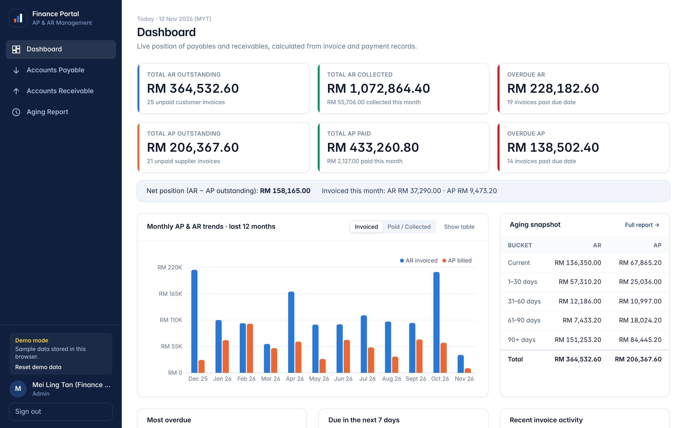
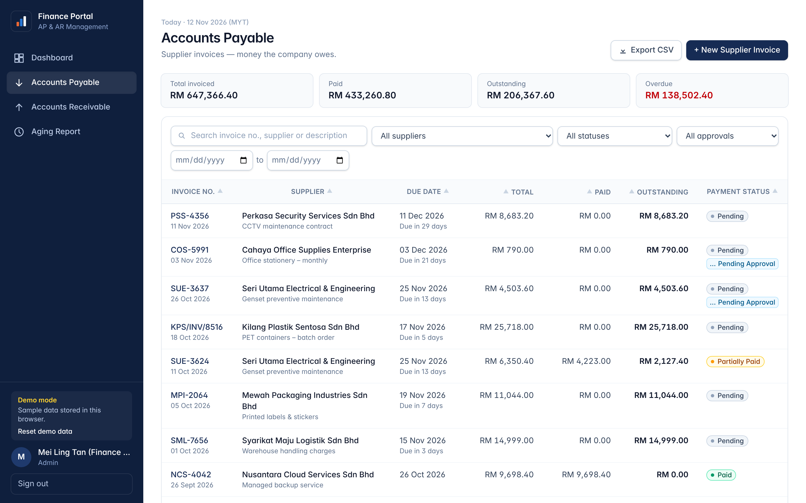
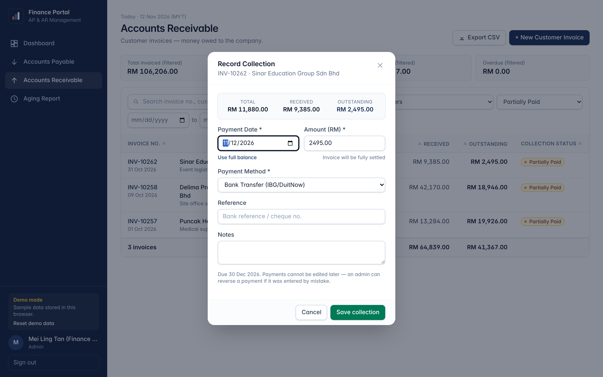
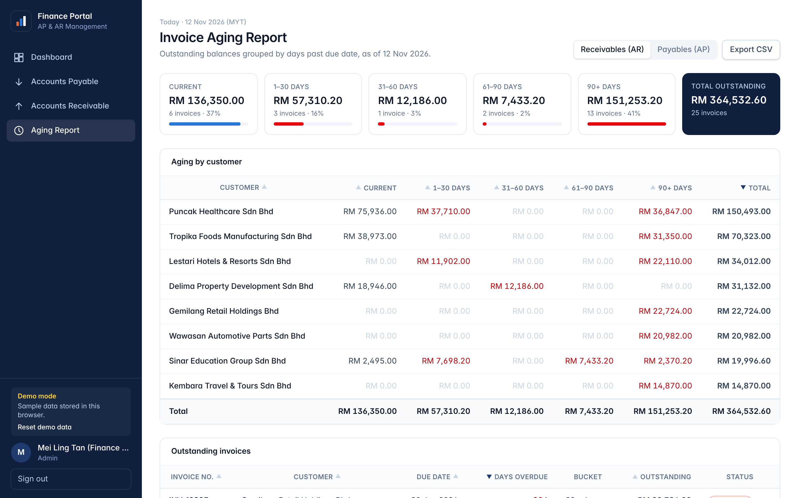

# Invoice AP & AR Management System

An internal finance website for tracking **Accounts Payable** (supplier invoices) and
**Accounts Receivable** (customer invoices), recording payments, and seeing what is outstanding
and overdue. Every figure is calculated live from invoice and payment records.

**Stack:** React 19 · TypeScript · Tailwind CSS 4 · Supabase (PostgreSQL + Auth + Row Level Security) · TanStack Query · Recharts
**Currency:** Malaysian Ringgit (RM), time zone Asia/Kuala_Lumpur

> 📐 Design, database schema, accounting rules and roadmap: [`docs/ARCHITECTURE.md`](docs/ARCHITECTURE.md)



| Accounts Payable | Record a collection | Aging report |
|---|---|---|
|  |  |  |

## Features

| Module | What it does |
|---|---|
| **Dashboard** | Total AP / AR outstanding, AP paid, AR collected, overdue AP / AR, net position, 12-month AP vs AR trend chart (invoiced or cash), aging snapshot, most-overdue and due-in-7-days lists, recent activity |
| **Accounts Payable** | Add / edit supplier invoices, SST tax helper, **approval workflow**, record full or partial payments, search, filters (supplier, payment status, approval status, date range), sort, totals, CSV export |
| **Accounts Receivable** | Create customer invoices, record full or partial collections, overdue tracking, search, filters, CSV export |
| **Aging Report** | Current / 1–30 / 31–60 / 61–90 / 90+ days for AP and AR, by supplier/customer and by invoice, CSV export |
| **Excel export** | Full report workbook (Summary + AR + AP + Payments + Aging) and per-list exports, print-ready |
| **Controls** | Duplicate-number check, overpayment guard, cancel with reason, restore, admin-only delete and payment reversal, full per-invoice history (audit log) |

### Roles

| Role | Can do |
|---|---|
| **Viewer** | See everything, export CSV. Read-only. *(e.g. directors / management)* |
| **Finance** | + create and edit invoices, record payments, cancel unpaid invoices |
| **Admin** | + approve/reject supplier invoices, reverse payments, delete invoices, manage roles |

Permissions are enforced **in the database** (Row Level Security + triggers), not just hidden in the UI.

## Using it on your own computer (no server, no account)

1. Run `npm install` then `npm run build:file`. This creates **`dist-file/InvoiceTracker.html`**: one file with everything inside.
2. Double-click the file to open it in Chrome or Edge. Bookmark it.
3. Sign in as **Mei Ling Tan (Admin)**. You start with sample data to explore; when ready, click
   **Start with my own data… → Remove sample data** and enter your real invoices.
4. Data is saved **in that browser on that computer**. Click **Backup** in the sidebar regularly
   (a reminder appears after 7 days) and keep the `.json` file somewhere safe (Google Drive, OneDrive).
   **My data… → Restore from backup** loads it again on any computer.
5. To report to management, click **Export full report to Excel** on the Dashboard. The workbook has
   *Summary, AR Invoices, AP Invoices, Payments, AR Aging, AP Aging* sheets, with RM formatting, filters,
   totals that follow filters (`SUBTOTAL`), and print-ready page setup. Each list and the aging report also
   has its own **Export to Excel** button, which exports exactly what is filtered on screen.

> Keep the HTML file in the same place: the browser links the saved data to the file's location.
> Clearing browser history / site data deletes the saved data, so keep backups.

## Quick start — development / demo mode

```bash
npm install
npm run dev
# open http://localhost:5173
```

Without Supabase settings the app runs in **demo mode**, with realistic sample data (fictional Malaysian
companies, ~120 invoices over 11 months) stored in your browser. Sign in with one click as:

| Account | Role |
|---|---|
| admin@demo.my | Admin (Finance Manager) |
| finance@demo.my | Finance (AP Executive) |
| boss@demo.my | Viewer (Director) |

Password for all: `demo1234`. Use **Reset demo data** in the sidebar to start over.

## Production setup with Supabase

1. **Create a project** at [supabase.com](https://supabase.com).
2. **Create the database.** In the Supabase *SQL Editor*, run the files in `supabase/migrations/` in
   order (`…0001_schema.sql`, `…0002_business_rules.sql`, `…0003_row_level_security.sql`).
   With the Supabase CLI you can instead run `supabase link` then `supabase db push`.
3. *(Optional)* Load the sample data by running `supabase/seed.sql`.
4. **Create users** in *Authentication → Users → Add user* (email + password). Every new user starts
   as a read-only **viewer**. Promote your first admin in the SQL Editor:
   ```sql
   update public.profiles set role = 'admin', full_name = 'Your Name' where email = 'you@company.com';
   ```
   After that, change roles the same way (`'finance'` or `'viewer'`).
   For sign-ups, turn off *Allow new users to sign up* in Auth settings so only invited staff get in.
5. **Configure the app:** copy `.env.example` to `.env.local` and fill in the values from
   *Project Settings → API*:
   ```
   VITE_SUPABASE_URL=https://xxxx.supabase.co
   VITE_SUPABASE_ANON_KEY=eyJ...
   ```
6. `npm run build` → deploy the `dist/` folder to any static host (Vercel, Netlify, Cloudflare Pages).
   `vercel.json` and `public/_redirects` are included so page refreshes work on those hosts.

## Testing

| Command | What it checks |
|---|---|
| `npm test` | 46 unit tests (including Excel export and backup/restore): money maths, every status rule, aging buckets, dashboard totals, trends, validation, CSV, demo-repository permissions and business rules |
| `npm run test:db` | 13 integration tests on a real PostgreSQL: duplicates, overpayment, approval, cancellation, audit log, RLS for every role. Needs `DATABASE_URL` (default `postgres://postgres@localhost:55432/postgres`) |
| `npm run test:e2e` | 21 Playwright browser tests that click through every flow, open the downloaded Excel files, and compare figures with the calculation engine (desktop, mobile, and the single HTML file opened from disk) |
| `npm run typecheck` / `npm run build` | Strict TypeScript and production build |

## Project structure

```
src/domain/        Pure business logic (no I/O): money, dates, invoice status, aging, dashboard, validation, CSV, permissions
src/data/          Repository interface + Supabase and demo implementations, sample data
src/hooks/         TanStack Query hooks (fetch + refresh after every change)
src/components/    Reusable UI: Button, Card, StatCard, DataTable, Modal, form fields, badges, toast, layout
src/features/      Pages: dashboard, invoices (AP/AR), aging, auth
supabase/          SQL migrations, seed data, DB test helpers
scripts/           Seed generator, database test runner
e2e/               Playwright end-to-end tests
```

Code comments are written in Traditional Chinese (繁體中文) for the maintaining team.
